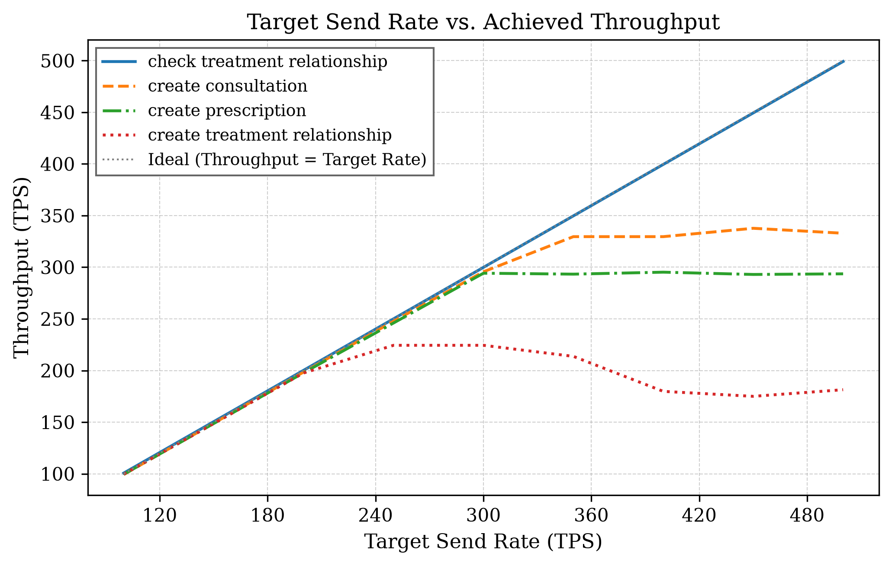
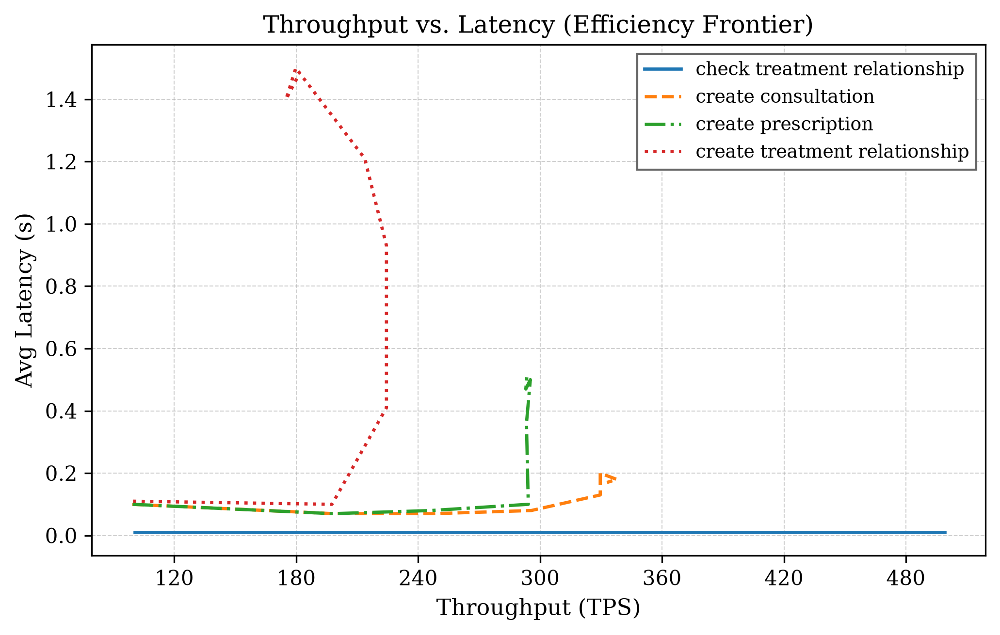
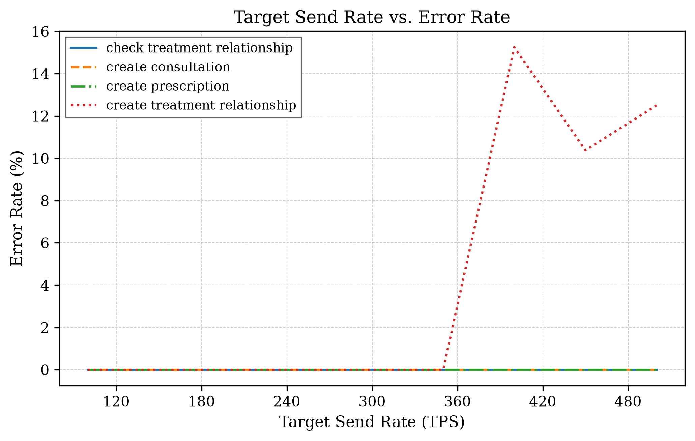

# Performance Evaluation Figures

## Figure: Send Rate vs. Achieved Throughput



All four operations track the requested send rate almost exactly up to
~100-200 TPS. Beyond that, they diverge sharply by operation type:
`check_treatment_relationship` (read) shows no ceiling through 500 TPS,
tracking the ideal line throughout. The three writes each plateau at a
distinct, measured ceiling: `create_consultation` and `create_prescription`
both saturate around **~330-340 TPS**, while `create_treatment_relationship`
saturates far lower, around **~180-225 TPS**, and its throughput actually
*declines* past that point as contention increases. This is a genuine,
reproducible network-side limit, not a benchmarking artifact — confirmed
by comparing runs at different client concurrency levels (2 vs. 4 Caliper
workers), where increasing client-side pressure did not raise real
committed throughput for `create_treatment_relationship`, only increased
failures.

## Figure: Throughput vs. Latency (Efficiency Frontier)



This view makes the cost of pushing past each operation's ceiling
explicit. `check_treatment_relationship` stays flat at ~10ms latency
across its entire throughput range — reads pay no latency penalty for
higher load in this topology. The three writes each show a
near-flat "efficient" region followed by a sharp latency spike once
throughput stops increasing: `create_prescription` and
`create_consultation` both hold latency under ~100-150ms up to their
~330-340 TPS plateau before rising toward 0.5s and 0.2s respectively;
`create_treatment_relationship` is the most severe, with latency climbing
past 1.4s once throughput plateaus near 180-225 TPS. The right-hand
"tail" on each write curve is the network absorbing excess load as
queueing delay rather than converting it into additional committed
throughput — the defining signature of a real saturation point.

## Figure: Send Rate vs. Failure Rate



Failures are entirely absent (0%) for all operations up to ~350 TPS,
including all three writes. Only `create_treatment_relationship` shows
failures, appearing sharply once send rate crosses its throughput
ceiling (~350-400 TPS target), reaching 10-15% failure rate at the
highest tested rates. These failures were confirmed via the peer's own
error message during benchmarking:
```
EndorseError: 2 UNKNOWN: too many requests for /gateway.Gateway,
exceeding concurrency limit (500)
```
This is the Fabric Gateway's own concurrency protection triggering, not a
misconfiguration — a citable, reproducible saturation point rather than
an inferred one. `create_consultation` and `create_prescription` reach
their throughput ceilings without producing any failures in the tested
range, meaning their true breaking point (as opposed to their practical
plateau) was not reached in this evaluation.
